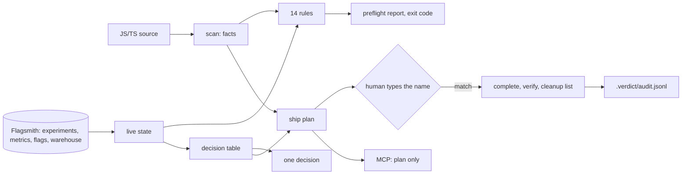

# Verdict for Flagsmith Experimentation

Verdict checks your code against your live Flagsmith experiments, gives one decision when results arrive, and ships the winner only after a person approves it.

It is a Node CLI, a stdio MCP server, a GitHub Action and an [Agent Skill](#agent-skill-track-04). Built for the Toggle Wars hackathon, Track 02 (AI Agents and Feature Flags) and Track 04 (Flagsmith Agent Skills).

## Install and authenticate

Needs Node 20 or later.

```
git clone https://github.com/satanrayshe/flagsmith-verdict
cd flagsmith-verdict
npm ci
npm run build
npm link        # puts `verdict` on your PATH
```

Verdict reaches Flagsmith in one of two ways, tried in this order:

1. **The Flagsmith CLI (preferred).** If [Flagsmith CLI v2](https://docs.flagsmith.com/integrating-with-flagsmith/CLI) is installed and `flagsmith auth status` succeeds, every request goes through `flagsmith api`. The credential stays in the CLI's keychain and Verdict never reads it.
2. **An API key.** Set `FLAGSMITH_API_KEY`, or point at a file with `--env-file <path>`.

Force one with `--transport cli` or `--transport api-key`.

The environment comes from `--environment <client-side key>`, then `FLAGSMITH_ENVIRONMENT`, then the `flagsmith.json` that `flagsmith init` writes.

## Flagsmith features used

| Feature | Where |
|---|---|
| Flagsmith CLI v2: `flagsmith api` as transport, `flagsmith eval` for verification, `flagsmith flag update` as the undo, `flagsmith auth status` | `src/flagsmith/cli-transport.ts`, `src/ship/execute.ts` |
| Flagsmith CLI v2 from an agent: `flagsmith config --jq`, `flagsmith api --jq` to list experiments in one line each, `flagsmith eval --jq`, `flagsmith flag get --jq` | `skills/flagsmith-ship-winner` |
| Experiments API: list, detail, exposures, results, both refresh endpoints, complete with a rollout decision | `src/flagsmith/client.ts` |
| Metrics API (event definitions) | VD005 |
| Warehouse connection and its received event names | VD008, preflight notes, decision row 3 |
| Multivariate flags, variation keys and weights | VD003, VD004, VD009, ship |
| SDK experiment calls: `getExperimentFlag`, `trackEvent`, `trackExposureEvent`, `flushEvents`, `close` | sample page and `examples/simulate.mjs` |
| SDK API identity evaluation | verification fallback when the CLI is not installed |

## Example: preflight on the broken sample app

```
$ verdict preflight test/fixtures/broken-app
verdict preflight
Mode: code + live Flagsmith configuration

ERROR VD001 Events are not enabled
  src/flags.js:6  await flagsmith.init({
  The SDK is initialised without enableEvents. getExperimentFlag then works as a plain flag read: the page renders, and no exposure or event is ever sent.
  Fix: Add enableEvents: true to the options.
  Docs: "Enable events when you create the client, with the environment key you already use for flags."
        https://docs.flagsmith.com/experimentation/run-an-experiment#initialise

ERROR VD005 Event name does not match the metric
  src/pricing.js:17  flagsmith.trackEvent('Signup');
  Metric "Sign-ups" (experiment "CTA copy") listens for "signup". This sends "Signup", which Flagsmith ignores.
  Fix: Rename the event to 'signup'.
  Docs: "The event name is case-sensitive and must exactly match the metric's configured event name. Unmatched events are silently ignored."
        https://docs.flagsmith.com/experimentation/run-an-experiment#track-conversions

ERROR VD009 Branch for a variation that does not exist
  src/pricing.js:9  if (flag.variant === 'start-free') {
  "cta_copy" has no variation "start-free", so this branch never runs. Variations: control, start_free.
  Fix: Change it to 'start_free'.
  Docs: "Your code will branch on the variation name, not the flag value, so keep names short and stable."
        https://docs.flagsmith.com/experimentation/example-paypal-button

WARN  VD004 Variation without a key
  Flagsmith: flag "verdict_scratch_nokey", experiment "Scratch nokey"
  Variation "no_key_variant" (id 37069) has no key. Flagsmith let the experiment be created, and every exposure of this variation is dropped.
  ...

WARN  VD011 Identity changes on every run
  src/flags.js:10  await flagsmith.identify('visitor-' + Math.random().toString(36).slice(2));
  ...

FAIL: 3 errors, 2 warnings, 1 info.
$ echo $?
1
```

That run is real: the sample app in `test/fixtures/broken-app` has mistakes planted on purpose, and the experiment, metric and variations come from a Flagsmith Cloud environment.

## The problem

An experiment can run for days and collect nothing, and no error is raised anywhere. Flagsmith's own documentation says so:

- "The SDKs skip events silently rather than throw." ([Run an Experiment, Troubleshooting](https://docs.flagsmith.com/experimentation/run-an-experiment#troubleshooting))
- "The event name is case-sensitive and must exactly match the metric's configured event name. Unmatched events are silently ignored." ([Track conversions](https://docs.flagsmith.com/experimentation/run-an-experiment#track-conversions))
- "Exposures are attributed by label, so a variation without one, for example one created through the API without a key, is not counted." ([Troubleshooting](https://docs.flagsmith.com/experimentation/run-an-experiment#troubleshooting))
- "No exposures recorded: a variation has no key, the user isn't identified before the experiment flag is requested, or the process exited before buffered events were sent." ([Set up with a coding agent](https://docs.flagsmith.com/experimentation/set-up-with-a-coding-agent))

Most of these mistakes sit in two places at once. The event name is in your code and in the metric. The variation key is in your `if` and in the flag. Neither side is wrong on its own, so a linter cannot see it and the dashboard cannot see it. Verdict reads both.

Once data does arrive, the analyse page has rules that are easy to skip under deadline: wait for 50 identities per variation, do not act on a sample ratio mismatch, treat an interval that crosses zero as inconclusive. `verdict status` applies them in a fixed order and prints one decision.

## What it does

### `verdict preflight [path]`

Scans a JavaScript or TypeScript codebase, loads the experiments, metrics, flags, variations and warehouse connection of the environment, and reports every mismatch with file, line, fix, and the Flagsmith doc sentence it is based on. Exit code 1 on any error, so it can gate CI.

- `--offline` runs only the code rules and needs no credentials.
- `--snapshot <file>` compares against a file written by `verdict snapshot` instead of calling Flagsmith. The file holds no keys, so a pull request from a fork can still be checked.
- `--format text|json|markdown`, `--fail-on error|warning`.

On the sample app a live run takes about 5 to 7 seconds on a laptop (the scan itself is about 30 ms; the rest is API calls), and about 0.3 seconds from a snapshot.

### `verdict status [experiment]`

Reads the experiment, its exposures and its results, asks Flagsmith to recompute results when they are more than 5 minutes old, and prints one decision with the reason and the rule behind it. Without an argument it covers every experiment in the environment.

```
$ verdict status
Plan toggle  flag plan_toggle, experiment 564, running
  DO NOT ACT: sample ratio mismatch
  The traffic split does not match the configured split: control 204 (expected 158), annual_first 111 (expected 158). p = 1.6e-7 (chi-square 27.46, computed by Verdict from the identities per variation). Something is dropping exposures for one variation, so the comparison is not trustworthy.

  variation     split  identities  Sign-ups  lift      95% interval      chance to beat control
  control       50%    204         19        baseline  -                 -
  annual_first  50%    111         8         -22.6%    -84.2% to +39.0%  23.6%

  Rule: "If a sample ratio mismatch warning appears, traffic didn't split the way you configured. Don't act on the results."
        https://docs.flagsmith.com/experimentation/analyse-an-experiment#results

Hero layout  flag hero_layout, experiment 563, running
  KEEP RUNNING
  Not enough data yet: control needs 28 more identities (has 22) and 2 more conversions (has 3); split_hero needs 32 more identities (has 18) and 2 more conversions (has 3).

  variation   split  identities  Sign-ups  lift        95% interval  chance to beat control
  control     50%    22          3         baseline    -             -
  split_hero  50%    18          3         collecting  -             -

  Rule: "While a variation has fewer than 50 identities (or fewer than 5 conversions, for occurrence metrics), it shows Collecting data. Keep the experiment running."
        https://docs.flagsmith.com/experimentation/analyse-an-experiment#results

CTA copy  flag cta_copy, experiment 562, running
  SHIP start_free
  start_free beats control on "Sign-ups": lift +28.2%, 95% interval +8.2% to +48.2%, chance to beat control 99.7%.

  variation   split  identities  Sign-ups  lift      95% interval     chance to beat control
  control     50%    2989        254       baseline  -                -
  start_free  50%    3011        328       +28.2%    +8.2% to +48.2%  99.7%
  Traffic split check: ok (p = 0.776, chi-square computed by Verdict).

  Rule: "When a variation reaches a 95% chance of beating control, a recommendation banner suggests rolling it out."
        https://docs.flagsmith.com/experimentation/analyse-an-experiment#results
  Results as of 2026-11-26T08:33:43.413762Z. Refresh: refreshed just now.
  Dashboard: https://app.flagsmith.com/project/54851/environment/<environment>/experiments/562
```

(Capture shortened: notes and footer lines of the first two experiments removed. The traffic behind these numbers is SIMULATED, see [Demo](#demo-sample-app-and-simulated-traffic). The lift, interval and chance are what Flagsmith computed.)

Exit codes: 0 for SHIP, KEEP CONTROL or ENDED; 10 for NOT STARTED, NO DATA YET, KEEP RUNNING or INCONCLUSIVE; 20 for BLOCKED, DO NOT ACT or DO NOT SHIP; 2 for errors. A scheduled job can branch on them.

`--format brief` prints one line per experiment with the decision first, for scripts and agents:

```
$ verdict status "CTA copy" --format brief --snapshot examples/demo-snapshot.json
SHIP start_free | CTA copy | experiment 562 | flag cta_copy | start_free beats control on "Sign-ups": lift +28.2%, 95% interval +8.2% to +48.2%, chance to beat control 99.7%. | results as of 2026-11-26T08:26:53.137534Z
```

### `verdict ship <experiment>`

Builds a change plan, shows it, and asks a person to type the experiment name. Only an exact match goes ahead.

```
$ verdict ship "CTA copy" --dry-run --path examples/pricing-page
Ship plan for "CTA copy" (flag cta_copy, experiment 562)
Decision: SHIP start_free
  start_free beats control on "Sign-ups": lift +28.2%, 95% interval +8.2% to +48.2%, chance to beat control 99.7%.

1. End the experiment and roll out start_free to everyone
   POST experiments/562/complete/ {"rollout_decision":"variant","rollout_variant":37064}
   Results are frozen as final, the flag is unlocked, and the weight of start_free is set to 100%.
2. Verify what users get
   flagsmith eval cta_copy --identity verdict-probe-1 ... verdict-probe-5
   Five fresh identities must all resolve to start_free. Retries for up to 40 seconds while the change propagates.
3. List code to clean up
   write .verdict/cleanup-cta_copy.md
   1 variation check on this flag found in the code.
   - app.js:33  if (flag.variant === 'start_free') {  (now always true)

Undo: flagsmith flag update cta_copy --weight start_free=0   (returns everyone to control; an ended experiment cannot be restarted)

Dry run: nothing was changed. To carry this out, a human runs: verdict ship "CTA copy"
```

Without `--dry-run` it then prompts `Type the experiment name to approve (CTA copy):`, runs the steps in order, stops at the first failure, prints the undo command, and appends a line to `.verdict/audit.jsonl`.

It refuses to plan when the decision is not SHIP or KEEP CONTROL. A person can pass `--override "<reason>"` (with `--winner <variation>` if there is no winner); the reason is written to the audit log.

### `verdict mcp`

A stdio MCP server with three tools, so an agent can check, decide and plan:

| Tool | What it returns | Writes to Flagsmith |
|---|---|---|
| `verdict_preflight { path, offline? }` | findings as text and JSON | no |
| `verdict_status { experiment?, refresh? }` | one decision per experiment, as text and JSON | only the results refresh, at most once every 5 minutes |
| `verdict_ship_plan { experiment, path? }` | the plan, and the exact `verdict ship` command a human must run | no |

There is no tool that ships. Configuration for any MCP client:

```json
{
  "mcpServers": {
    "verdict": {
      "command": "npx",
      "args": ["-y", "github:satanrayshe/flagsmith-verdict", "mcp"],
      "env": { "FLAGSMITH_ENVIRONMENT": "<client-side environment key>" }
    }
  }
}
```

Or locally: `node /path/to/flagsmith-verdict/dist/cli.js mcp`.

### GitHub Action

```yaml
name: Experiment preflight
on: pull_request
jobs:
  verdict:
    runs-on: ubuntu-latest
    steps:
      - uses: actions/checkout@v4
      - uses: satanrayshe/flagsmith-verdict@main
        with:
          path: .
          environment: ${{ vars.FLAGSMITH_ENVIRONMENT }}
          api-key: ${{ secrets.FLAGSMITH_API_KEY }}
```

The report is written to the job summary as a table and the job fails on any error. With `snapshot: path/to/verdict-snapshot.json` (or `offline: 'true'`) it needs no secret at all. This repository's own [CI workflow](.github/workflows/ci.yml) runs the action on the sample pricing page against the saved demo snapshot.

## Agent Skill (Track 04)

[`skills/flagsmith-ship-winner`](skills/flagsmith-ship-winner) is an [Agent Skill](https://agentskills.io/specification) that takes an agent through one whole job with the Flagsmith CLI: from "is this experiment ready?" to "winner shipped and verified".

| Step | Command | Output |
|---|---|---|
| 1. Find the experiment | `flagsmith api "api/v1/environments/$FLAGSMITH_ENVIRONMENT/experiments/" --jq <filter>` | one line per experiment: id, status, name, flag |
| 2. Get the decision | `verdict status "<name>" --format brief` | one line and an exit code; anything but SHIP or KEEP CONTROL stops here |
| 3. Show the plan | `verdict ship "<name>" --dry-run` | the API call, the verification, code to clean up, the undo command |
| 4. Hand over | none | the agent asks a person to run `verdict ship "<name>"` and waits |
| 5. Verify and record | `node scripts/verify.mjs "<name>"` | one line from `flagsmith eval` on five fresh identities, and one line appended to `.verdict/audit.jsonl` |
| 6. Report | none | four lines, with the rollback command |
| 7. Remove the dead flag code, if asked | `git grep`, `verdict preflight`, `gh pr create` | a pull request that passes preflight |

`SKILL.md` is 90 lines. The decision table, the rollback steps, the clean-up pull request and a path that needs only the Flagsmith CLI (no Verdict) sit in four `references/` files that the agent opens only when it needs them.

**Install.** Copy the folder into the skills directory your agent reads, for example:

```
git clone https://github.com/satanrayshe/flagsmith-verdict
cp -r flagsmith-verdict/skills/flagsmith-ship-winner <your agent's skills folder>/
```

It needs the Flagsmith CLI v2 logged in (`flagsmith login`, `flagsmith init`), Node 20 or later, and `verdict` on PATH or through `npx -y github:satanrayshe/flagsmith-verdict`.

**Safety rules.**

- The agent only reads. Every command block in `SKILL.md` is read-only, and a test checks that.
- The one production write is `verdict ship`, and a person runs it and types the experiment name. If the agent runs it, it exits 3 with nothing changed, because no terminal is attached.
- The skill forbids the ways around that: `flagsmith api -X POST`, `flagsmith flag update`, `--yes`, `--override`, piping input.
- The agent says before the hand-off that an ended experiment cannot be restarted.
- A decision that is not SHIP or KEEP CONTROL ends the run with the reason. The agent does not look for a way past it.
- `scripts/verify.mjs` never writes to Flagsmith, evaluates identities without storing them, and never prints the environment key.
- Rollback is documented, and it is also a person's command: `flagsmith flag update <flag> --weight <variation>=0`.

**Demo run and token count.** Recorded on 27 Nov 2026 on a scratch experiment in the demo environment with SIMULATED traffic (400 identities). The whole job took four commands. The full record is in [`examples/skill-run.md`](examples/skill-run.md).

| Part | Characters | Tokens (about) |
|---|---|---|
| `SKILL.md`, loaded once | 4,118 | 1,030 |
| The four commands the agent wrote | 403 | 101 |
| All output the agent read | 1,603 | 401 |
| **Total** | **6,124** | **1,531** |

Tokens are characters divided by 4, rounded up. No tokenizer was used, so these are estimates. For scale, the experiment list without `--jq` is 4,202 characters of JSON on its own.

Two things about that run. The approval prompt was answered by a test harness that called the same `ship()` function as the command, so no person typed the name. And before it did, the agent's own attempt at `verdict ship` was refused with exit 3. Afterwards the rollback command was run on the scratch flag, three fresh identities came back as `control`, and the scratch flag and experiment were deleted.

## Rule reference

Errors fail the run. Warnings are heuristics and do not, unless you pass `--fail-on warning`. Rules marked "yes" compare code with Flagsmith and are skipped by `--offline`.

| Rule | Level | Needs Flagsmith | What it catches |
|---|---|---|---|
| [VD001](https://docs.flagsmith.com/experimentation/run-an-experiment#initialise) | error | no | SDK initialised without `enableEvents` while the code uses experiments. In the browser nothing fails: the flag reads work and no exposure is sent |
| [VD002](https://docs.flagsmith.com/experimentation/run-an-experiment#sdk-overview) | error | no | `@flagsmith/flagsmith` below 12.4.0, `@flagsmith/nodejs` below 9.1.0, or the old `flagsmith-nodejs` / `flagsmith` packages |
| [VD003](https://docs.flagsmith.com/experimentation/create-an-experiment#0-pre-requisites) | error | yes | `getExperimentFlag('x')` or `useExperiment('x')` where `x` is not a flag in the project or has no variations |
| [VD004](https://docs.flagsmith.com/experimentation/run-an-experiment#troubleshooting) | error | yes | A variation without a key on a running experiment. The API accepts it and its exposures are dropped (warning when your code does not read that flag) |
| [VD005](https://docs.flagsmith.com/experimentation/run-an-experiment#track-conversions) | error | yes | The metric's event name is never sent by `trackEvent`; near misses such as `Signup` for `signup` are pointed out with the fix |
| [VD006](https://docs.flagsmith.com/experimentation/run-an-experiment#track-conversions) | error | no | `trackEvent('$...')`: names starting with `$` are reserved |
| [VD007](https://docs.flagsmith.com/experimentation/run-an-experiment#record-exposures) | warning | no | Node client with `enableLocalEvaluation: true` that asks for experiment flags |
| [VD008](https://docs.flagsmith.com/experimentation/run-an-experiment#troubleshooting) | error | yes | No warehouse connection, or one that is errored or has received nothing |
| [VD009](https://docs.flagsmith.com/experimentation/example-paypal-button) | error | yes | A branch on a variation name that the flag does not have, such as `'start-free'` for `start_free` |
| [VD010](https://docs.flagsmith.com/experimentation/run-an-experiment#instrument-your-application) | warning | no | Browser code that asks for an experiment flag and never identifies the user |
| [VD011](https://docs.flagsmith.com/experimentation/example-paypal-button) | warning | no | Identity from `Math.random()`, `Date.now()` or `randomUUID()` that is not stored |
| [VD012](https://docs.flagsmith.com/experimentation/set-up-with-a-coding-agent) | warning | no | Server-side `trackEvent` without an `identifier` |
| [VD013](https://docs.flagsmith.com/experimentation/run-an-experiment#initialise) | warning | no | Server client that buffers events with no `close()` or `flushEvents()` anywhere |
| [VD014](https://docs.flagsmith.com/experimentation/run-an-experiment#record-exposures) | warning | no | `trackExposureEvent` without an `inExperiment` check |

`verdict rules` prints the same list.

## Decision table

Rows are applied in order and the first match wins. Thresholds are the ones on Flagsmith's [analyse page](https://docs.flagsmith.com/experimentation/analyse-an-experiment) and [statistics glossary](https://docs.flagsmith.com/experimentation/statistics).

| # | Condition | Decision | Exit |
|---|---|---|---|
| 1 | Experiment is a draft | NOT STARTED | 10 |
| 2 | Experiment has ended | ENDED, with what every user now gets | 0 |
| 3 | No warehouse, or one that is errored or has received no events | BLOCKED | 20 |
| 4 | Results not computed, or computed with no exposures | NO DATA YET | 10 |
| 5 | 100 or more identities and the split differs from the configured one with p below 0.001 | DO NOT ACT: sample ratio mismatch | 20 |
| 6 | A variation has fewer than 50 identities, or fewer than 5 conversions on an occurrence metric | KEEP RUNNING, with the shortfall | 10 |
| 7 | A guardrail metric has a 95% or higher chance of moving the wrong way | DO NOT SHIP | 20 |
| 8 | A variation has a 95% or higher chance to beat control and its interval is clear of zero | SHIP that variation | 0 |
| 9 | Every variation is at 5% or lower | KEEP CONTROL | 0 |
| 10 | Anything else | INCONCLUSIVE | 10 |

Row 5 uses `srm_p_value` from Flagsmith when the API returns one. When it is null, Verdict runs a chi-square goodness-of-fit test on the identities per variation against the configured split and says in the output that the number is its own. The decision function is pure and lives in [`src/decide/decide.ts`](src/decide/decide.ts).

## Approval and audit

- `verdict ship` asks for the experiment name, typed in full. Anything else aborts with no changes (exit 4).
- There is no `--yes` flag and no environment variable that skips the prompt.
- Without a terminal on stdin and stdout it refuses (exit 3). A CI job or an agent running the command cannot approve.
- The MCP server has no ship tool. `verdict_ship_plan` ends with the command a person must run.
- Every attempt, including refusals and aborts, appends one JSON line to `.verdict/audit.jsonl`: time, experiment, winner, the numbers the decision was based on (identities, lift, interval, chance, as-of time), the override reason if any, the approver (`git config user.name`, or the OS user), and each step with its HTTP status. Keys and email addresses are never written.

Flagsmith's own audit logs and change requests are part of its paid plans. Verdict does not replace them. It gives a team on the free plan a typed approval and a local record for one specific action: rolling out an experiment winner.

## How it compares

| | Flagsmith's set-up prompt for coding agents | Flagsmith MCP server | Verdict |
|---|---|---|---|
| Main job | Create the flag, metric and experiment and instrument the app | Read and edit flags, experiments and metrics from an agent | Check the instrumentation, decide on results, gate the rollout |
| Reads your source code against the live setup | no | no | yes |
| Can end an experiment and roll out a winner | yes, the agent runs the API call | no start, complete or rollout tools | yes, only after a typed approval at a terminal |
| Runs in CI | no | no | yes |

They fit together: set an experiment up with the prompt, then let Verdict watch it.

## Demo: sample app and simulated traffic

Everything in the demo is labelled, and nothing here was measured on real users.

- **SAMPLE app.** [`examples/pricing-page`](examples/pricing-page) is a static page that runs the `cta_copy` experiment with `@flagsmith/flagsmith`. Copy `config.example.js` to `config.js`, put in your client-side environment key, and serve the folder with any static server. [`test/fixtures/broken-app`](test/fixtures/broken-app) is the same idea with four mistakes planted on purpose, and `test/fixtures/fixed-app` has them corrected. The `demo/broken` branch plants the same four mistakes in the sample page itself, so a pull request from it fails the preflight job in CI.
- **SIMULATED traffic.** [`examples/simulate.mjs`](examples/simulate.mjs) sends synthetic identities through `@flagsmith/nodejs` with a seeded random generator. Conversion chances are fixed in the script:
  - `cta_copy`: control 0.08, `start_free` 0.12. After the first 600 identities the result was INCONCLUSIVE (the draw went against the configured rates), so the experiment kept running to 6,000, where Flagsmith reported the numbers shown above.
  - `hero_layout`: 40 identities, too few to act on.
  - `plan_toggle`: 400 identities, and about 40% of `annual_first` exposures are deliberately not recorded, as if that variation crashed before rendering. This produces the sample ratio mismatch.
- **Results are Flagsmith's.** Lift, interval and chance to beat control in every capture are what Flagsmith computed from that traffic. They were not edited.
- [`examples/demo-snapshot.json`](examples/demo-snapshot.json) is the output of `verdict snapshot` on the demo environment on 26 Nov 2026. It lets you reproduce every capture without an account:

```
verdict preflight test/fixtures/broken-app --snapshot examples/demo-snapshot.json
verdict status --snapshot examples/demo-snapshot.json
verdict ship "CTA copy" --dry-run --snapshot examples/demo-snapshot.json
```

To reproduce against your own environment, follow Flagsmith's [set-up guide](https://docs.flagsmith.com/experimentation/set-up-with-a-coding-agent) to create a multivariate flag `cta_copy` with a keyed variation `start_free`, a metric on the event `signup` and an experiment, then run `FLAGSMITH_SERVER_KEY=... node examples/simulate.mjs cta_copy`. For a flag with other names, `node examples/simulate.mjs custom --flag <flag> --rates control=0.1,<variation>=0.4` sends the same kind of traffic.

One real finding from building this: the demo environment holds a paused experiment, "Scratch nokey", on a flag whose variation was created through the API without a key. Flagsmith created and started that experiment without complaint. VD004 reports it.

## Limits

- JavaScript and TypeScript only in this version. Python, Java, Go and Flutter SDKs are not scanned.
- The scanner follows values inside one file: a flag stored in a variable, destructuring, `switch`, optional chaining. It does not follow a flag object passed between modules, and it reads only string literals, so event or flag names built at run time are not checked (VD005 says so when it sees one).
- VD007 and VD010 to VD014 are heuristics. They can miss cases and can report code that is fine, which is why they are warnings.
- Flagsmith's experimentation API is in beta. Response shapes were recorded on 26 Nov 2026 (API version 2.295) and all parsing sits in [`src/flagsmith/normalize.ts`](src/flagsmith/normalize.ts).
- Flagsmith's warehouse card can read "Pending Connection" while events are arriving and results compute. Verdict then goes by the event count and adds a note.
- The sample pricing page has been checked by `verdict preflight` and its SDK calls match the documented API, but it has not been run through a browser test suite.
- `verdict ship` cannot restart an experiment. The undo command puts everyone back on control.

## Development

```
npm ci
npm test        # builds, then runs the tests
```

The tests need no Flagsmith account and make no network calls. They cover every rule, every row of the decision table, the sample ratio maths against hand-computed values, the normaliser against recorded API responses, the approval and audit paths, the built CLI end to end, the MCP server over stdio, the skill's layout and frontmatter against the Agent Skills specification, and the skill's script against a stand-in for the Flagsmith CLI.

```
src/
  cli.ts              commands: preflight, status, ship, snapshot, rules, mcp
  flagsmith/          transports (CLI, API key), typed client, normaliser
  scan/               file walk and fact extraction with @babel/parser
  rules/              the 14 preflight rules
  decide/             decision table and sample ratio test
  ship/               plan, typed approval, execution, audit log
  mcp/server.ts       stdio MCP server
  render/             text, JSON and markdown output
examples/             SAMPLE pricing page, SIMULATED traffic script, demo snapshot, skill demo run
skills/               the flagsmith-ship-winner Agent Skill: SKILL.md, scripts/, references/
test/                 tests, fixture apps, recorded API responses
```



## Licence

MIT
